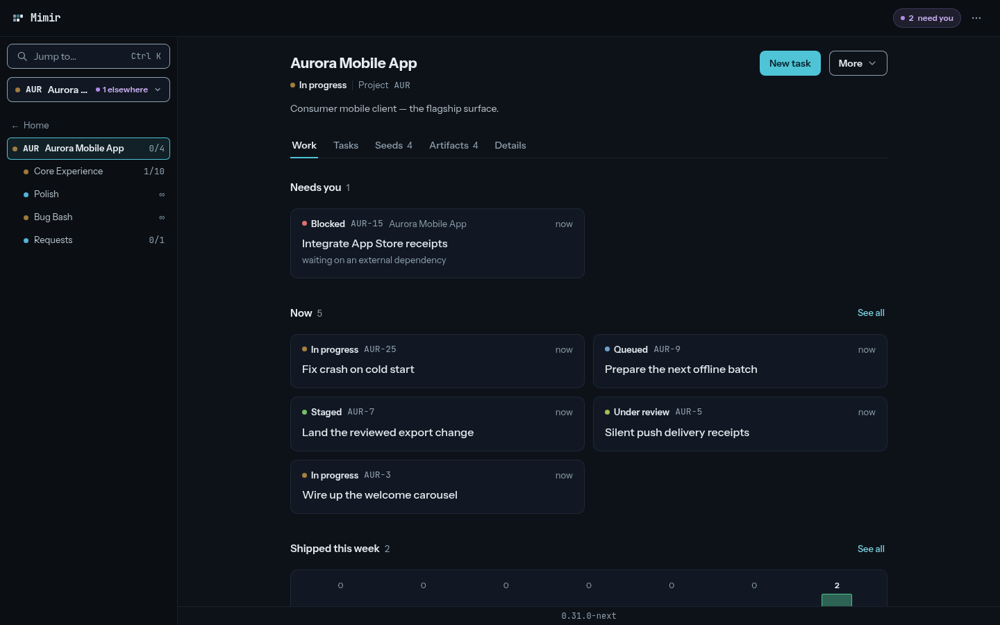

# Use the operator console

The console is the operator's view across agent-driven work. It shows current
state from the same core used by the CLI and MCP server, then provides focused
authoring and lifecycle controls.

The host container serves the console. Follow the
[host guide](../guides/host.md) to run it, then open `http://localhost:64647/`.
For access from another device, `tailscale serve` keeps HTTPS and the
installable PWA, and a
[reverse proxy](../guides/host.md#use-a-reverse-proxy) does too.

## Review what needs you

The console opens on Home at `/`: one column for every active project at
once. Its title is today's date, such as "Monday, 23 November". One sentence
under the title counts what needs you, what is running, and what shipped this
week, for example "3 cards need you, holding 4 items. 9 tasks are running, and
3 have shipped this week." When nothing needs you, runs, or shipped, it reads
"A quiet week". Home has no rail: your projects are in the
[sidebar](#find-your-way-with-the-sidebar).

Below the sentence come up to four sections, in this order. A section with
nothing to show is left out. When this browser can turn on
notifications and you have not yet answered, a card above the sections
suggests turning them on.

- **Needs you** shows the decisions waiting on you as a deck of cards, in one
  ranked order across projects. A card is a stopped delivery, a delivery's
  provisional decisions, a project's decisions without a delivery, a task
  blocked on you, or a task with a question for you. Decisions hold up agents,
  so they come first. The head reads "N cards, M items": the cards, then the
  records they hold, which is the number on the top-bar alert. On a phone the
  deck shows one card at a time, and you swipe or use Previous and Next. From
  768px wide it shows pages of four. **See all** opens the
  [Needs you page](#the-needs-you-page). When nothing needs you, the line
  "Nothing needs you." takes the section's place.
- **Now** shows the work in flight across your projects as cards: tasks
  queued, in progress, in review, or staged, with the latest move first. Each
  card shows the task's status, ID, project, age, and title. Home shows four
  cards on a phone and six from 768px wide. When more are running, the head
  says how many show, such as "6 of 9". A task in review waits on its review
  gate, such as a pull request, which asks for you when it needs you. A staged
  task passed its review and is accepted on its branch, but its code has not
  reached `main` yet.
- **Shipped this week** shows how many tasks finished as done on each of the
  last seven days, with today's count so far, then the count for each project.
  An abandoned task is not counted.
- **When you have a minute** counts what can wait: **Seeds to triage**,
  **Ready to start**, **Going cold**, and **Doctor findings**, across projects.
  A count of zero is left out. Home lists none of them one by one. Start a
  runnable task from its project's work page, and triage a seed from the
  seed's own page.

Tap a card in Needs you or Now to open its preview: a bottom sheet on a phone,
or a panel from the right on a wider screen. The preview shows why the card is
here, the facts that matter, the card's action when it has one, and
**Open**, which goes to the record's page. A Now card has no action. The actions are **Clear stop** on a stopped delivery,
**Answer…** on a task with a question, and **Review N decisions** on a set of
decisions, which opens their walkthrough. A task blocked on you has no action
here. Clear the block outside Mimir, then unblock the task from its page. When
an action settles what a card asks, the card leaves the deck and the next card
takes its place. An answer that leaves the task with another question keeps
its card, which then shows the new question. Offline, **Clear stop** and
**Answer…** do nothing until the console reconnects; **Review N decisions**
still opens its walkthrough.

The top-bar **Needs you** alert shows how many decisions wait on you, the same
number as Home's "M items" and the installed app's badge. It opens the Needs
you page, at every width. The alert is hidden when there are no decisions.
Seeds, findings, and tasks going cold never light it.

### The Needs you page

The Needs you page at `/needs-you` lists everything that needs you, grouped by
project. Under the title, one sentence counts it, for example "10 cards, 26
items in 3 projects." Each project has its own section, headed by the
project's name and its count, such as "3 cards, 5 items". The project whose
card is most urgent comes first, and each project's cards follow in their
ranked order. The cards are the same cards as Home's deck, with the same
previews and actions, and the page shows all of them: nothing pages or folds.
When an action settles what a card asks, the card leaves, and if focus was on
it, focus moves to the next card. A project's section leaves with its last
card.

A bar at the bottom of the page holds **Work through all N**, where N is the
number of items. It opens focus mode at `/?mode=focus`, which walks the
items one at a time in queue order across projects. **Back to the list**, or
finishing the last item, returns you to the Needs you page. **Work through
all** stays available offline; the actions inside focus mode wait for the
connection.

When nothing needs you, the page shows "Nothing needs you." and no bar.

## Work within a project

Every project, initiative, phase, task, seed, and artifact has its own page at
its own address: `/p/MMR` for the project, `/p/MMR/417` for `MMR-417`,
`/p/MMR/s41` for the seed `MMR-s41`, and `/p/MMR/a219` for the artifact
`MMR-a219`. Typing a bare ID such as `/MMR-417`, `/mmr-s41`, `/mmr-a219`, or
`/mmr` redirects to its page.

- **A project, initiative, or phase opens as its work page.** The main column
  answers five questions in order: _Now_ (what is queued, running, in
  review, or staged, with when it started, where, and its latest note), _Needs you_
  (blocks you can clear and tasks that need answers, each with its reason),
  _Frontier_ (what is runnable now, what is next to unlock, what is left to
  groom, and what is waiting on others, folded), _Shipped_ (the last seven
  days, grouped by day), and _Going cold_ (stale work). Every row opens its
  record page. Some rows also act in place: Start on a runnable task, and
  Answer… on a task that needs answers, which saves your answer as a note and
  sets the task's grooming state. The row then moves to
  the section it now belongs in. Offline, these buttons are disabled. The rail
  holds the direction (clamped to a few lines, with Read more for the rest),
  About (the description and details), and Artifacts (a project's five newest,
  with a link to all of them when it has more than five). A link to all of the
  project's tasks closes the five sections. New task is in the page head, and a
  project's settings sit beside it. An initiative or phase keeps its notes under
  a Timeline tab, at `?tab=timeline`. Its place in the project is marked in the
  sidebar, and below 1024px wide a link to its parent stands above its ID.
- **A task page** shows its description, a timeline with a note field, and a
  rail with actions, agent context, dependencies, artifacts, and details. The
  sidebar lists the task under its phase or initiative, and below 1024px wide a link
  to that parent (or to the project) stands above its ID.
- **A seed page** reads as a request: which board asks which, the description,
  and what came of it, meaning the tasks promoted from the seed and the tasks
  on any board that name it as upstream. A decision block offers the verbs the
  seed needs next: promote, reject, or park a new seed for later; promote,
  unpark, or reject a parked seed; promote again or reject while its work is
  under way; and resolve, promote again, or
  reject once that work has settled. Its rail holds Edit, Copy link, and
  details.
- **An artifact page** shows the frozen body under the work it is attached to.
  The path runs through that task, a card for the task sits above the body,
  and the rail lists the task's other artifacts. An artifact attached to
  several records lists each in the card, and its path stops at the nearest
  container that holds them all; one attached to none sits under its project.
  The rail holds Copy link, Download .md, and details.

On a phone, the rail folds into chips that open bottom sheets.

## Find your way with the sidebar

A sidebar on the left frames every page. On a project's pages it frames that
project. On `/` and `/doctor`, which belong to no project, it frames All
projects: the header reads **All projects** with a violet count of the
decisions waiting across every project, and only **Work** sits under it, which
is `/`. Choose a project in the switcher to get its outline, Tasks, Seeds, and
Artifacts back. With no projects, there is no sidebar on the work pages, and
Home offers **New project**. [Settings](#settings) pages and `/pair`
have a sidebar either way.

- **The header** names the project by key and title. When other projects have
  decisions waiting, it adds "N elsewhere" in violet. Choose it to open the
  project switcher.
- **The switcher** opens on **All projects**, which leads to `/` and is marked
  when you are on `/` or `/doctor`. It carries a violet count of the decisions
  across every project and no pin, and it is hidden while you type a search.
  Below it are pinned projects first, then the rest by most recent
  activity. Each row shows the project's key and title, a violet count of its
  decisions when it has any, and a mark on the project you are in. Type to
  filter by key or title, press the up and down arrows to move, and press Enter
  to switch. Switching keeps your section: from `/p/MMR/tasks` it opens the
  new project's Tasks, and from a record it opens the new project's work page.
  Escape closes the switcher and returns focus to the header. Press Alt+P to
  pin or unpin the highlighted project, or click the pin icon on its row; either
  works without leaving the page, and a pin is saved with the project, so it
  follows you to other devices. Archived projects are in a folded **Archived**
  section at the bottom; they cannot be pinned, and they open to a page that
  names the project as archived and offers **Unarchive**, which returns you to
  its work page.
  **New project** ends the list.
- **Work** opens the project's work page (on All projects, `/`). Under it, an outline lists the
  project's initiatives and phases, each with its done-over-total count, ∞
  when open-ended, or _parked_. Finished initiatives fold into one line you can
  open. Tasks are not in the outline unless you have one open.
- **Tasks**, **Seeds**, and **Artifacts** open the project's browsers. The
  section you are in is marked, and a record counts toward its section: a
  task's page is in Tasks, a seed's in Seeds, an artifact's in Artifacts, and
  an initiative's or phase's in Work.
- **The outline marks the open record's place.** The initiatives and phases
  above it are ringed, an open initiative or phase is highlighted, and an open
  task appears under its nearest container. A finished initiative opens when
  the record sits inside it.

Below 1024px wide, such as on a phone or a small tablet, the sidebar is a drawer. The button at the left of the top bar
opens it. Choosing a section or record closes it. Escape or a tap outside
also closes it and returns focus to the button.

The top bar holds the Mimir brand (a link to Home), the jump
palette, **Needs you**, and the **…** menu. At every width, the **…** menu holds
**Settings**, then the theme switch, then the update check when the console
runs installed. A waiting update puts a dot on the **…** button.

## Settings

**Settings**, at `/settings`, is the console's one settings area. Open it from
the **…** menu. It lists its pages in two groups, each row showing its current
value:

- **This device** holds **Appearance** (Light, Dark, or Match system). Match
  system clears the stored pick, so the console follows the operating system
  again. The choice is stored in this browser.
- **Host** holds **Devices** (the pairing requests waiting, else the number
  paired), **Connections** (the T3 Code state), and **About** (the console
  version).

On these pages and on `/pair`, the sidebar lists the same pages, with **← Back
to work** at the top. The page you are on is marked. On `/pair` it marks
**Devices**. On a phone the sidebar is the drawer, and each page opens with a
**← Settings** link.

- **Devices** (`/settings/devices`) lists the requests waiting to pair and the
  paired devices, with a confirmed **Unpair**. Approve a request on `/pair` with
  the code the device shows. The old `/devices` address opens this page.
- **Connections** (`/settings/connections`) holds the T3 Code connection:
  its state and **Connect T3** or **Reconnect T3**. T3's sign-in returns here
  and reports its outcome once. With T3 not set up, the page says that no
  connections are set up on this host.
- **About** (`/settings/about`) shows the host and console versions, the update
  check when the console runs installed, and a link to Record health at
  `/doctor`.

## Browse a project's records

Each project has three browsers, at `/p/KEY/tasks`, `/p/KEY/seeds`, and
`/p/KEY/artifacts`. The sidebar links to the project you are in. The old
addresses `/tasks`, `/seeds`, and `/artifacts` still work: with `?project=KEY`
they open that project's browser, and without it they open the last project
you visited on this device, else the first in the project switcher. With no
projects at all they open Home.

- **Tasks** for the project's tasks, grouped by status, with
  **Live** and **Finished** views and a search over titles and IDs;
- **Artifacts** for frozen work products, grouped by the day they were frozen,
  each showing the records it is attached to;
- **Seeds** for the grooming queue, grouped by lane: untriaged, ready to
  resolve, and promoted, with parked and settled seeds folded behind **Show
  parked seeds** and **Show settled seeds**.

The cross-project surface for record health is separate: **Record health**
shows `mimir doctor` findings, the rows the store holds in an inconsistent
state, each with its table, key, and evidence.

The tasks, artifacts, and seeds browsers show a one-line preview of each
record's description or summary under its title, and every row opens the
record's own page. On a phone the previews are hidden, and the groups stay.

Routes and filters are encoded in the URL, so a specific view can be bookmarked
or shared.

## Understand offline behavior

The console is an installable PWA. It keeps the last synchronized reads and
shows an explicit offline banner when the server cannot be reached. Offline
data is for inspection only: writes are disabled and never queued for later.
