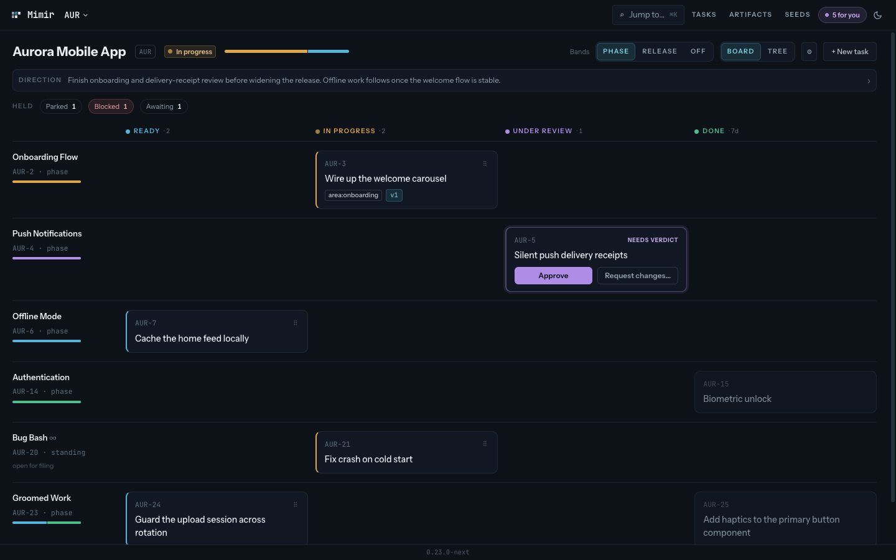

# Use the operator console

The console is the operator's view across agent-driven work. It shows current
state from the same core used by the CLI and MCP server, then provides focused
authoring and lifecycle controls.

```sh
mimir serve
```

Open the URL printed at startup. The installed production profile defaults to
`http://127.0.0.1:64647/`. The server binds to loopback unless `[serve] bind`
says otherwise. For access from another device, pick a
[network mode](../guides/port-and-proxy.md): `tailscale serve` keeps HTTPS and
the installable PWA, and a reverse proxy does too.



## Review what needs you

The console opens on the review page at `/`. It lists what waits on you
across every active project, in two sections:

- **Decide** lists the decisions, grouped by project: tasks in review, blocks
  only you can clear, and tasks that need answers. Decisions hold up agents, so
  they come first. When nothing waits, the section says so and names how many
  tasks are in progress and which task finished last. Decisions act in place,
  as on a work page: Approve and Send back… on a task in review, and Answer…
  on a task that needs answers. A block has no action here. Clear it outside
  Mimir, then unblock the task from its page.
- **Triage when you have a minute** is a table with one row per project. Each
  row counts untriaged seeds, the age of the oldest one, tasks going cold, and
  `mimir doctor` findings. Open a row to list its untriaged seeds, oldest
  first, each with Promote to task…, Reject…, and Park…. The going-cold count
  opens the project's work page, and the findings count opens its record
  health.

When a row you act on leaves the page, keyboard focus moves to the next row.
Offline, the row actions are disabled.

The rail lists every active project with its decisions, its triage count, and
its tasks in progress. Each entry opens the project's work page. Archived
projects are on a shelf under the list, beside **New project**. On a phone, the
list is behind the **Projects** chip.

The top-bar **Needs you** alert shows how many decisions wait on you. It opens
a popover (a bottom sheet on a phone) that lists them grouped by project, in
the same order as this page, so you can decide without leaving the page you are
on. Each row has the same buttons as here (**Approve**, **Send back…**,
**Answer…**), and the decision for the record you are viewing is marked _This
page_. A row leaves the list when its change lands, and the popover stays open
until you press Escape, choose a link, or move to another page. It links to
**Open review page** and to **Work through these**, the one-at-a-time queue.
The alert is hidden when there are no decisions. Seeds, findings, and tasks
going cold never light it.

## Work within a project

Every project, initiative, phase, task, seed, and artifact has its own page at
its own address: `/p/MMR` for the project, `/p/MMR/417` for `MMR-417`,
`/p/MMR/s41` for the seed `MMR-s41`, and `/p/MMR/a219` for the artifact
`MMR-a219`. Typing a bare ID such as `/MMR-417`, `/mmr-s41`, `/mmr-a219`, or
`/mmr` redirects to its page.

- **A project, initiative, or phase opens as its work page.** The main column
  answers five questions in order: _Now_ (what is running, with when it
  started, where, and its latest note), _Needs you_ (reviews, blocks you can
  clear, and tasks that need answers, each with its reason), _Frontier_ (what
  is runnable now, what is next to unlock, what is left to groom, and what is
  waiting on others, folded), _Shipped_ (the last seven days, grouped by day),
  and _Going cold_ (stale work). Every row opens its record page. Some rows
  also act in place: Start on a runnable task, Approve and Send back… on a
  task in review, and Answer… on a task that needs answers, which saves your
  answer as a note and sets the task's grooming state. The row then moves to
  the section it now belongs in. Offline, these buttons are disabled. The rail
  holds the direction (clamped to a few lines, with Read more for the rest),
  About (the description and details), and Artifacts (a project's five newest,
  with a link to all of them when it has more than five). A link to all of the
  project's tasks closes the five sections. New task is in the page head, and a
  project's settings sit beside it. An initiative or phase keeps its notes under
  a Timeline tab, at `?tab=timeline`. Its place in the project is marked in the
  sidebar, and below 1024px wide a link to its parent stands above its ID.
- **A task page** shows its description, a timeline with a note field, and a
  rail with actions, agent context, dependencies, artifacts, and details. The
  sidebar lists the task under its phase or initiative, and below 1024px wide a link
  to that parent (or to the project) stands above its ID.
- **A seed page** reads as a request: which board asks which, the description,
  and what came of it, meaning the tasks promoted from the seed and the tasks
  on any board that name it as upstream. A decision block offers the verbs the
  seed needs next: promote, reject, or park a new seed for later; promote,
  unpark, or reject a parked seed; promote again or reject while its work is
  under way; and resolve, promote again, or
  reject once that work has settled. Its rail holds Edit, Copy link, and
  details.
- **An artifact page** shows the frozen body under the work it is attached to.
  The path runs through that task, a card for the task sits above the body,
  and the rail lists the task's other artifacts. An artifact attached to
  several records lists each in the card, and its path stops at the nearest
  container that holds them all; one attached to none sits under its project.
  The rail holds Copy link, Download .md, and details.

On a phone, the rail folds into chips that open bottom sheets.

## Find your way with the sidebar

A sidebar on the left frames every page for the current project. The current
project is the one in the address, else the last one you visited on this
device, else the first in the project menu. With no projects, there is no
sidebar; the review page offers **New project**.

- **The header** names the project by key and title. Choose it to open the
  project menu, which lists every project with its ready count and ends with
  **New project**.
- **Work** opens the project's work page. Under it, an outline lists the
  project's initiatives and phases, each with its done-over-total count, ∞
  when open-ended, or _parked_. Finished initiatives fold into one line you can
  open. Tasks are not in the outline unless you have one open.
- **Tasks**, **Seeds**, and **Artifacts** open the project's browsers. The
  section you are in is marked, and a record counts toward its section: a
  task's page is in Tasks, a seed's in Seeds, an artifact's in Artifacts, and
  an initiative's or phase's in Work.
- **The outline marks the open record's place.** The initiatives and phases
  above it are ringed, an open initiative or phase is highlighted, and an open
  task appears under its nearest container. A finished initiative opens when
  the record sits inside it.

Below 1024px wide, such as on a phone or a small tablet, the sidebar is a drawer. The button at the left of the top bar
opens it. Choosing a section or record closes it. Escape or a tap outside
also closes it and returns focus to the button.

The top bar holds the Mimir brand (a link to the review page), the jump
palette, **Needs you**, and the theme toggle.

## Browse a project's records

Each project has three browsers, at `/p/KEY/tasks`, `/p/KEY/seeds`, and
`/p/KEY/artifacts`. The sidebar links to the current project's. The old
addresses `/tasks`, `/seeds`, and `/artifacts` still work: with `?project=KEY` they open that project's browser, and without it they
open the current project's. With no projects at all they open the review page.

- **Tasks** for the project's tasks, grouped by status, with
  **Live** and **Finished** views and a search over titles and IDs;
- **Artifacts** for frozen work products, grouped by the day they were frozen,
  each showing the records it is attached to;
- **Seeds** for the grooming queue, grouped by lane: untriaged, ready to
  resolve, and promoted, with parked and settled seeds folded behind **Show
  parked seeds** and **Show settled seeds**.

The cross-project surface for record health is separate: **Record health**
shows `mimir doctor` findings, the rows the store holds in an inconsistent
state, each with its table, key, and evidence.

The tasks, artifacts, and seeds browsers show a one-line preview of each
record's description or summary under its title, and every row opens the
record's own page. On a phone the previews are hidden, and the groups stay.

Routes and filters are encoded in the URL, so a specific view can be bookmarked
or shared.

## Understand offline behavior

The console is an installable PWA. It keeps the last synchronized reads and
shows an explicit offline banner when the server cannot be reached. Offline
data is for inspection only: writes are disabled and never queued for later.
